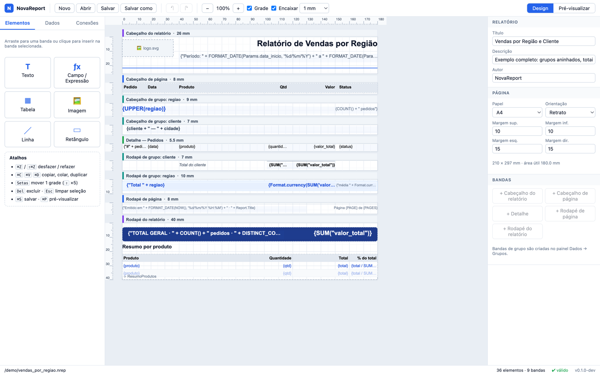
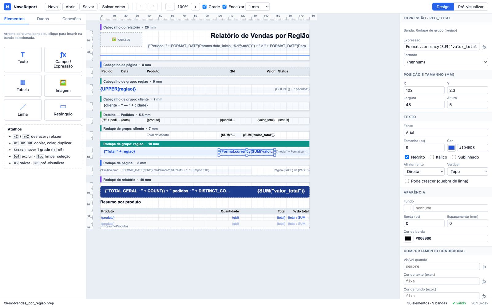
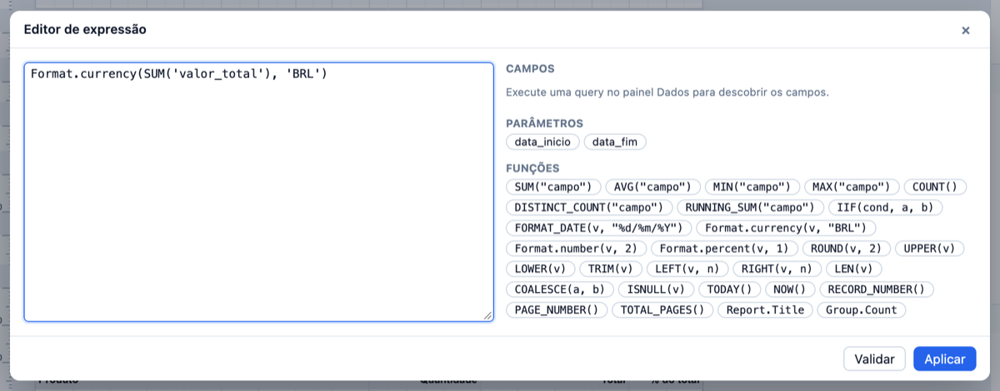
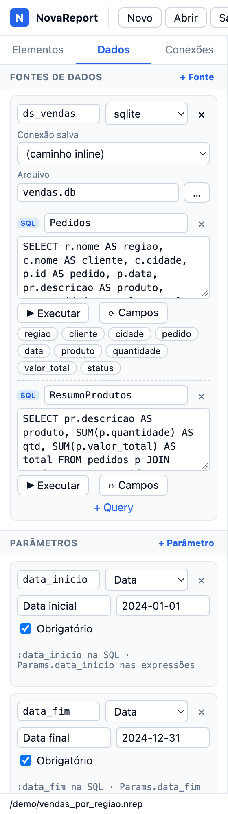
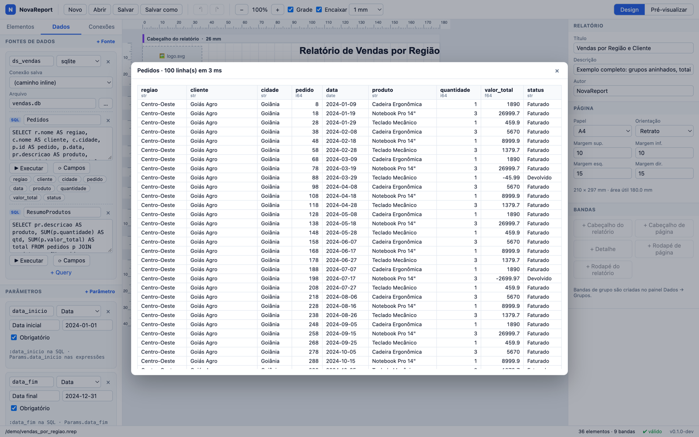
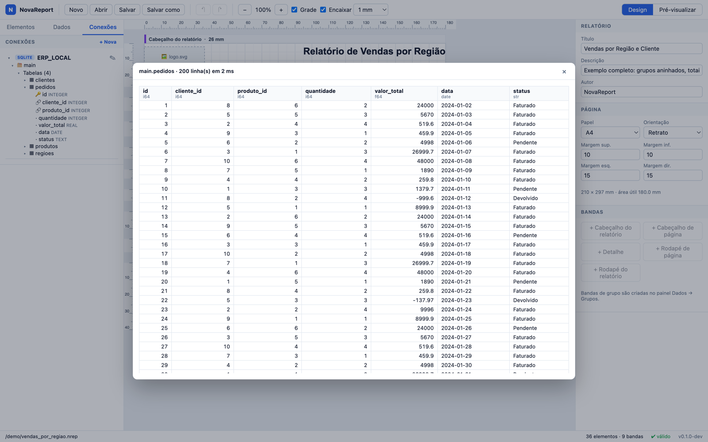
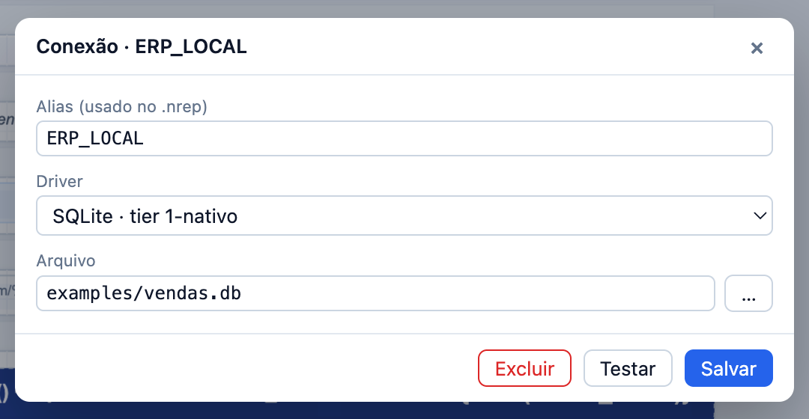
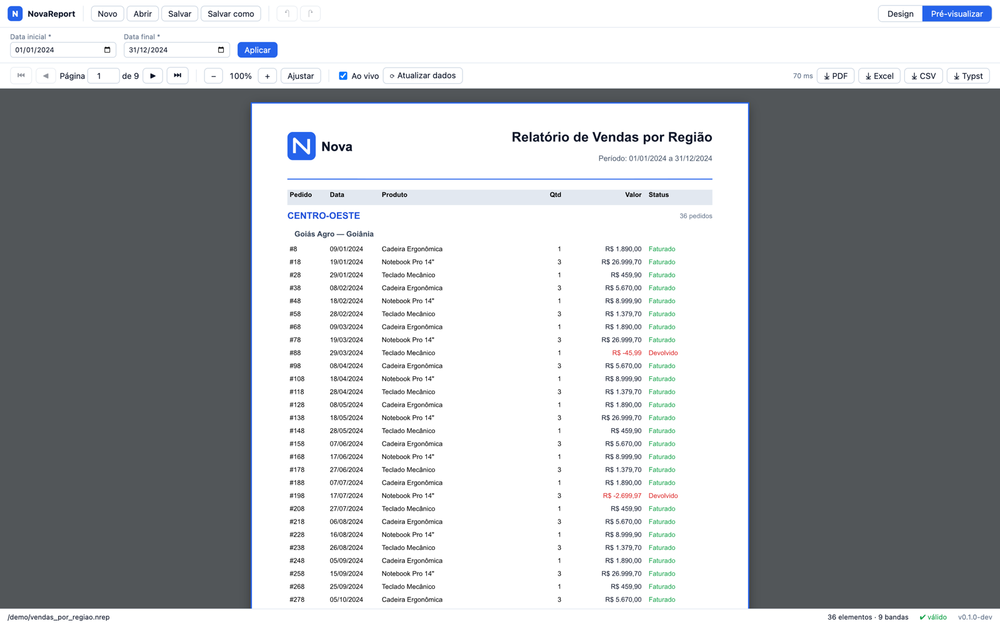
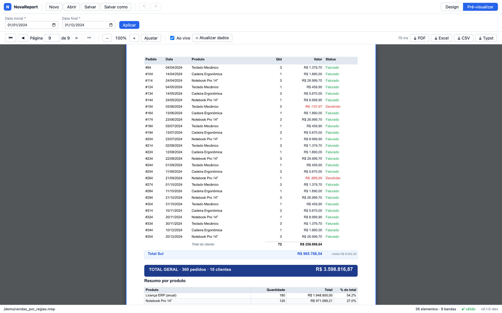

# NovaReport Builder

Construtor de relatórios desktop (Fase 1) — **Rust + Tauri 2 + React/Konva + Typst + Polars + Rhai**.
Designer WYSIWYG por bandas, formato declarativo `.nrep`, múltiplos bancos de dados e
geração de PDF pixel-perfect em memória.

Arquitetura e decisões: [docs/ARCHITECTURE.md](docs/ARCHITECTURE.md).



Veja o [tour pelas telas](#telas) para conhecer cada parte do programa.

## Início rápido

Pré-requisitos: Rust ≥ 1.85 (testado em 1.94), Node ≥ 20, `cargo install tauri-cli --version ^2`.

```bash
# app desktop (designer)
cd apps/desktop
npm install
cargo tauri dev            # abre o NovaReport Builder

# CLI headless (mesmo engine)
cargo run --release -p nova-cli -- render examples/vendas_por_regiao.nrep -o vendas.pdf
cargo run --release -p nova-cli -- render examples/vendas_por_regiao.nrep -o vendas.xlsx
cargo run --release -p nova-cli -- render examples/vendas_por_regiao.nrep -p data_fim=2024-06-30
cargo run --release -p nova-cli -- validate examples/vendas_por_regiao.nrep
cargo run --release -p nova-cli -- render examples/vendas_zebrado.nrep -o zebrado.pdf   # linhas zebradas
cargo run --release -p nova-cli -- render examples/vendas_cascata.nrep -p regioes=1,3 -p clientes=1,5,6   # parâmetros em cascata (vários valores)
cargo run --release -p nova-cli -- drivers

# testes
cargo test --workspace
cargo test -p nova-engine --release -- --ignored --nocapture perf_   # critério de desempenho
```

No app, use **Abrir** e escolha `examples/vendas_por_regiao.nrep` (SQLite incluso em `examples/vendas.db`).

Para desenvolver só a interface no navegador, sem o backend Rust: `cd apps/desktop && npx vite`
e abra `http://localhost:1420/?demo` (IPC simulado por `src/infra/devMock.ts`, só em dev).

## Funcionalidades

| Área | Implementado |
| :--- | :--- |
| **Designer** | Bandas (report/page/group header-footer, detail) redimensionáveis; réguas em mm; grade e encaixe; guias magnéticas; arrastar entre bandas (reparenting); seleção por laço e múltipla; alinhar/distribuir; desfazer/refazer ilimitado; copiar/colar/duplicar; drag-and-drop de campos |
| **Elementos** | Texto (com `{PAGE}`/`{PAGES}`), expressão com formato, imagem (arquivo/data URI/SVG), linha, retângulo, tabela com quebra de página, cabeçalho repetido, zebra e rodapé com totais |
| **Expressões (Rhai, sandbox)** | `Fields.x`, `Params.x`, `Group.Sum_x`; `SUM/AVG/MIN/MAX/COUNT/DISTINCT_COUNT/RUNNING_SUM`, `IIF`, `FORMAT_DATE`, `Format.currency/number/percent/date`, `PAGE_NUMBER/TOTAL_PAGES`... Visibilidade e cores condicionais |
| **Dados** | Grupos aninhados com subtotais, parâmetros tipados (com defaults `today`, `firstDayOfMonth`), múltiplas queries por relatório, cache de dados no preview |
| **Conectores** | SQLite, PostgreSQL, MySQL/MariaDB, SQL Server, ODBC (Oracle, DB2, HANA... — feature `odbc`), CSV/JSON com SQL em memória (Polars), REST/JSON |
| **Conexões** | Navegador de schema estilo DBeaver (tabelas, views, colunas, PK/FK, procedures), pré-visualização de dados, senha no cofre do SO (Keychain / Credential Manager / Secret Service) — o `.nrep` nunca guarda senhas |
| **Saída** | Preview paginado (SVG) ao vivo, PDF vetorial (Typst), XLSX com tipos nativos e fórmulas `SUM`, CSV, código Typst |

## Telas

As capturas abaixo usam o relatório de exemplo `examples/vendas_por_regiao.nrep` com os dados de `examples/vendas.db`.

### Designer de bandas


O designer é a tela principal. Ela tem três colunas:

- **À esquerda**, as abas *Elementos*, *Dados* e *Conexões*. Na aba *Elementos* ficam os elementos que podem ser inseridos (texto, campo/expressão, tabela, imagem, linha e retângulo) e um lembrete dos atalhos de teclado.
- **No centro**, a página dividida em bandas, cada uma com cor e altura em mm: cabeçalho do relatório, cabeçalho de página, cabeçalhos e rodapés de grupo, detalhe, rodapé de página e rodapé do relatório. Há réguas em milímetros e grade com encaixe opcional (0,5 a 5 mm). Cada banda pode ser redimensionada arrastando a borda inferior. Os elementos podem ser movidos entre bandas, alinhados por guias magnéticas e selecionados em grupo por laço ou com Shift.
- **À direita**, as propriedades do item selecionado. Sem seleção, ela mostra os dados do relatório (título, papel, orientação e margens) e os botões para incluir bandas.

A barra superior reúne arquivo (Novo, Abrir, Salvar), desfazer/refazer, zoom e opções de grade. Ela também alterna entre os modos *Design* e *Pré-visualizar* (⌘P). A barra inferior mostra o arquivo aberto, a contagem de elementos e bandas e o resultado da validação contínua. Um clique nesse resultado abre a lista de erros e avisos.

### Propriedades do elemento



Ao selecionar um elemento, o painel da direita mostra:

- a banda em que ele está;
- a expressão e o formato de saída (moeda, número, percentual, data…);
- posição e tamanho em mm;
- fonte, tamanho, cor, negrito, itálico, sublinhado e alinhamento horizontal e vertical;
- *Pode crescer*, para quebrar o texto em várias linhas;
- fundo, borda e espaçamento interno.

Em **Comportamento condicional**, a visibilidade, a cor do texto e a cor de fundo podem depender de uma expressão. O exemplo usa isso para pintar de vermelho os pedidos devolvidos.

### Editor de expressões



O botão **ƒx**, ao lado de qualquer campo de expressão, abre o editor. Ele lista os campos das queries, os parâmetros do relatório e as funções disponíveis. Um clique em um item acrescenta-o ao final da expressão. **Validar** verifica a sintaxe no próprio motor de expressões (Rhai, em sandbox) antes de aplicar.

### Fontes de dados, parâmetros e grupos



A aba **Dados** define de onde vêm os dados do relatório:

- **Fontes de dados**: cada fonte tem um driver e usa uma conexão salva, um caminho de arquivo ou uma variável de ambiente. Uma fonte pode ter várias queries SQL.
- **Executar** roda a query e mostra o resultado. **Campos** descobre as colunas, que aparecem como chips e podem ser arrastadas para o designer.
- **Parâmetros** são tipados (texto, número, data, booleano…) e têm rótulo, valor padrão e obrigatoriedade. Nas queries, eles são usados como `:nome`; nas expressões, como `Params.nome`.
- **Grupos** criam os cabeçalhos e rodapés de grupo, com subtotais e quebra de página opcional entre grupos.

<br clear="right">



O resultado da query mostra cada coluna com o tipo inferido pelo engine (Polars), o número de linhas e o tempo de execução.

### Conexões e navegador de schema



A aba **Conexões** guarda os perfis de banco de dados usados pelos relatórios. Cada perfil pode ser expandido em um navegador de schema no estilo DBeaver, com schemas, tabelas, views, procedures e colunas. Chave primária e estrangeira têm ícones próprios, e cada coluna mostra seu tipo nativo. Em cada tabela:

- **dados** mostra as primeiras linhas;
- **+ query** adiciona um `SELECT` da tabela ao relatório.



O formulário de conexão adapta os campos ao driver escolhido: arquivo para SQLite, e host, porta, banco, usuário, senha e TLS para servidores. O botão **Testar** valida o acesso antes de salvar. A senha vai para o cofre do sistema operacional (Keychain, Credential Manager ou Secret Service). O `.nrep` guarda apenas o *alias* da conexão. A CLI usa as mesmas conexões e senhas salvas pelo desktop.

### Pré-visualização e exportação



No modo **Pré-visualizar**, o relatório é renderizado pelo mesmo engine da CLI e do PDF final (Typst):

- o topo mostra os parâmetros do relatório; **Aplicar** gera o relatório de novo com os valores informados;
- a barra de ferramentas tem navegação entre páginas, zoom e *Ajustar*;
- **Ao vivo** atualiza a prévia a cada alteração no design;
- **Atualizar dados** ignora o cache e consulta o banco de novo;
- o tempo da última renderização aparece à direita, junto com a exportação para **PDF**, **Excel**, **CSV** e **Typst**.



A última página do exemplo mostra:

- o subtotal por cliente;
- o total da região, com média;
- o *TOTAL GERAL*, que usa `COUNT()` e `DISTINCT_COUNT()`;
- a tabela *Resumo por produto*, alimentada por uma segunda query, com a coluna de percentual sobre o total.

## Estrutura

```
crates/
  nova-domain        Agregado .nrep, value objects, invariantes, ports (sem I/O)
  nova-engine        DataContext (Polars), FormulaEngine (Rhai), bandas, transpilador Typst, exportadores
  nova-application   Casos de uso: render/preview/export, conexões, documentos
  nova-connectors    Infraestrutura: drivers, dialetos SQL, introspecção, cofre, repositórios
  nova-cli           Composição headless (CI, servidores, testes)
apps/desktop
  src-tauri          Composition root + comandos IPC
  src                React: designer (Konva), painéis, preview
examples/            vendas.db + vendas_por_regiao.nrep + vendas_zebrado.nrep + vendas_cascata.nrep
proto/               Contrato gRPC para conectores sidecar (Tier 3)
docs/ARCHITECTURE.md Decisões de arquitetura
```

## Desempenho medido (MacBook, release)

| Critério (spec Fase 1) | Meta | Medido |
| :--- | :--- | :--- |
| Preview com caches quentes | < 50 ms até 50 páginas | ~40 ms para 97 páginas (layout 8 ms + Typst 25 ms) |
| Execução completa via CLI (processo frio) | — | ~75 ms para 9 páginas / 360 linhas |
| Memória | < 150 MB | 103 MB de pico (CLI com fontes do sistema) |
